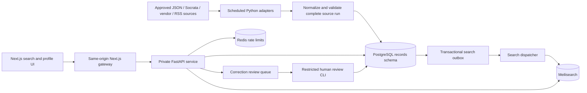

# JailMap authorized-records scaffold

The landing page, authentication and member/admin workspaces are now implemented.
See [ACCOUNT_SETUP.md](ACCOUNT_SETUP.md) for current setup, validation and limitations.
The earlier map/Prisma TypeScript errors described in the original validation
section below were repaired during that work; the complete production build now passes.

## 1. Architecture and stack



Keep the existing Next.js 16 / React 19 map. Add Python FastAPI for a separately
scalable API and ingestion runtime, PostgreSQL as the source of truth, Meilisearch
for fuzzy and last-token prefix matching, and Redis for shared rate limits.
This is a working scaffold, not an activated national data service. No live
source is configured and no deployment or database migration was performed.
The only existing UI change is a Search bookings navigation link.

The existing Prisma models remain separate. `backend/schema.sql` creates a new
`records` schema; do not treat the existing `Roster` table as synchronized.
An explicit migration/mapping plan is needed before consolidating them.

At higher volume, partition operational work by jurisdiction, use a queue with
per-source concurrency/backoff, and increase the API replica count. Use connection
budgets/PgBouncer, metrics for source freshness and outbox age, encrypted backups,
restore drills, and search-index rebuild jobs. Keep disclosure checks on the
primary database: a lagging replica can expose records after suppression.
Do not cache public booking responses at the CDN.

## 2. Database schema

See [backend/schema.sql](backend/schema.sql) for executable PostgreSQL DDL.

| Table | Purpose and identity |
| --- | --- |
| jurisdictions | State, county, facility, HTTPS endpoint, adapter and authorization reference; disabled by default |
| inmates | One booking per `(jurisdiction_id, booking_number)`; stable UUID for profile links |
| charges | Complete charge set; source child IDs unique within booking |
| bonds | Complete bond set; exact decimal USD amount, type and status; null means unknown |
| search_outbox | Latest pending indexing version per booking |
| correction_requests | Private human review queue with reviewer, timestamp and audit note |

Do not merge people by name or DOB. If a provider reuses booking numbers, its
adapter must supply a stable booking-episode key (or evolve the unique constraint
before enabling that source). DOB and mugshot URL exist in the restricted data
model but are excluded from both the public projection and index. Collect them
only when necessary and permitted. Do not ingest sealed/juvenile records under
the default public contract; adapters must enforce source-specific eligibility.

Indexes include a trigram GIN index for lowercased full names, a last/first-name
B-tree, location lookup and jurisdiction/date indexes. Child unique constraints
also index their booking foreign keys. Meilisearch handles user-facing fuzzy
search; PostgreSQL name indexes support controlled administrative lookups.

## 3. Backend ingestion and search

`backend/normalize.py` defines the feed contract. `backend/ingest.py` registers
adapters, fetches same-endpoint cursor pages with time/size/page bounds, validates
the entire run, and writes each jurisdiction transactionally. Failed runs leave
that jurisdiction unchanged. Older source revisions cannot overwrite newer
ones. Suppression survives every subsequent upsert. Missing bookings are not
assumed released; explicit release status hides them, and observations older
than 48 hours are hidden from public APIs. That freshness cutoff is a scaffold
default to review per source. Empty snapshots do not release everyone.

Example **synthetic** JSON response (the timestamps below are examples):

```json
{
  "items": [{
    "booking_number": "EXAMPLE-001",
    "first_name": "Example",
    "last_name": "Person",
    "booking_date": "2025-01-01T12:00:00Z",
    "updated_at": "2025-01-02T12:00:00Z",
    "status": "in_custody",
    "charges": [{"id": "c1", "statute": null, "description": "Synthetic example", "severity": null}],
    "bonds": [{"id": "b1", "amount": "100.10", "type": "cash", "status": "set"}]
  }],
  "next_cursor": null
}
```

This contract requires complete charge/bond lists, not partial change events.
An adapter must resolve incremental events into complete records before upsert.
Vendor authentication belongs in a secret store; never in `source_url`.
The provided adapter is hypothetical standardized JSON. Socrata, vendor and RSS
adapters are extension points, not implemented integrations. Socrata adapters
need dataset-specific field mappings and stable ordered pagination; RSS adapters
need safe XML parsing and an explicit policy for incremental event semantics.
No HTML scraping, captcha bypass or unauthorized connector is included.

`backend/search.py` configures searchable names, state/county filters and conservative
typo tolerance. Prefix matching uses the engine default. Only IDs are returned
from search; the API hydrates current records from PostgreSQL, rechecks visibility,
freshness and location, and never discloses stale indexed fields. Names reside
in the private index, so Meilisearch must not be exposed directly to browsers.

Outbox events commit with booking updates. Dispatch waits for Meilisearch task
success before deleting the matching event version. A serialized dispatcher
prevents out-of-order index writes. Newer events survive acknowledgment of older
versions; retries are idempotent. One batch handles 100 bookings per invocation;
scale the dispatcher/queue for larger workloads. Database rechecks protect stale
index hits, but stale names can temporarily influence matching until indexed.
Search pages can be short/empty after filtering; `has_more` indicates more index
candidates, not a verified total. Scheduled retention/index cleanup remains a
production requirement; suppression is not physical erasure from backups/indexes.

## 4. REST API and safeguards

| Endpoint | Behavior |
| --- | --- |
| `GET /api/search?name=Example&state=MT&county=Example&page=1` | Name 2–100 chars, state two uppercase letters, optional exact county, 25/page, max 40 pages; `{items,page,has_more}` |
| `GET /api/inmate/{booking_id}` | Booking UUID, charges, separate bonds, facility/source/observation time; 404 for unavailable records |
| `GET /api/jurisdictions` | Enabled facilities with state, county and last successful run |
| `POST /api/corrections` | `{booking_id,email,kind,reason}`; generic 202 acknowledgment; no automatic deletion |

FastAPI uses parameterized SQL and validated input. The private gateway authenticates
with a random server token. Redis atomically limits reads to 60/minute and requests
to 5/minute per client bucket, returns 429/Retry-After, and fails closed when Redis
is unavailable. Next.js bounds correction payloads to 16 KiB and checks origin.
Use an edge request-size/connection limit for the entire service; the Python port
must be private. Configure a trusted client header only if the edge overwrites it
and prevents direct gateway access. Otherwise visitors share one conservative
bucket. Forwarded headers from arbitrary clients are not trusted by default.

Correction requests are private. Restrict DB access and use verified operator
credentials for this CLI after human review:

```sh
python -m backend.review REQUEST_UUID --reviewer operator-id --note "Verified source correction; suppressed pending amended source"
```

Approval suppresses the booking and enqueues index removal in one transaction.
For a correction, keep it hidden while the source is amended and verified.
Restoration/rejection/admin dashboards are future work; do not silently unhide
records on reingestion. Implement an authenticated audited restoration workflow
before permitting republication. The CLI's reviewer string is an audit label,
not authentication: access is controlled by operator environment/DB credentials.

Before production: establish jurisdiction-specific legal basis, eligibility,
retention/erasure schedules, source contracts, review deadlines and escalation
ownership. Restrict public API/worker/reviewer database roles separately; this
scaffold does not provision those roles. Encrypt contact information and backups,
avoid payload/query/body logs, and purge closed request contact details according
to approved retention. No fees for correction/removal. UI disclaimers do not
establish legal compliance or exempt screening use from FCRA obligations.

## 5. Frontend components

- `src/app/search/page.tsx`: accessible search page and coverage explanation.
- `src/components/records/SearchRecords.tsx`: debounced keyboard autocomplete,
  labeled name/state/county fields, live status, results table and pagination.
- `src/app/inmate/[booking_id]/page.tsx`: booking layout and noindex metadata.
- `src/components/records/BookingProfile.tsx`: charges, individual bond terms,
  source timestamps and correction/removal form.
- `src/components/records/Disclaimer.tsx`: presumed innocence, stale data and
  identity-match caveats. Unknown bond is never displayed as zero or totaled
  across potentially alternative bond instruments.

## 6. Local setup and validation

Use a separate PostgreSQL development database, Redis and Meilisearch. Dependencies
are listed as compatible ranges; resolve, security-review and lock exact versions
before release. No service is automatically started or provisioned by this scaffold.

```sh
python -m venv .venv
# Activate .venv (Windows: .venv\Scripts\Activate.ps1)
python -m pip install -r backend/requirements.txt
# Export backend/.env.example values using your shell or secret manager.
# .env files are documentation templates and are NOT automatically loaded by Python.
psql "$DATABASE_URL" -v ON_ERROR_STOP=1 -f backend/schema.sql
python -m backend.search --configure
python -m uvicorn backend.api:app --host 127.0.0.1 --port 8000
```

In Next.js `.env.local`, set `RECORDS_API_URL=http://127.0.0.1:8000` and the
same `RECORDS_API_TOKEN`. Never prefix secrets with `NEXT_PUBLIC_`. Run `npm run dev`
and open `/search`. With no service configured, the UI reports unavailability
instead of showing invented bookings. Enable a jurisdiction only after its
authorization, mapping, endpoint, host allowlist and eligibility are reviewed.

`backend/cron.example` runs ingestion daily at 03:15 UTC and outbox dispatch each
minute. Import it into an appropriately configured UTC cron host; it is not
installed automatically. Use process supervision and alerts for failures and
outbox/freshness lag. Sources are isolated per transaction; automatic HTTP
backoff/dead-letter handling is an extension for the production queue.

```sh
python -m unittest backend.test_normalize
python -m compileall -q backend
# Isolated DB only, schema applied, Python dependencies installed:
# Set RECORDS_TEST_DATABASE=1 and DATABASE_URL to the disposable DB.
python -m unittest backend.test_integration
npx tsc --noEmit
npx tsc --project tsconfig.records.json --noEmit
```

Integration test covers duplicate ingestion, child replacement, suppression
preservation and stale-source rejection. Live PostgreSQL/Redis/Meilisearch API,
outbox recovery and browser accessibility tests are required before release.
Existing map API/Prisma checks remain independent and may require repair.

Scaffold validation performed: eight normalization tests passed; Python files
compiled; scoped frontend lint and TypeScript checks passed. Next.js HTTP smoke
checks returned 200 for `/search` and a profile layout, and the expected 503 JSON
for an unconfigured records API. These were HTTP checks, not browser interaction
or accessibility tests. The opt-in PostgreSQL test was skipped
because no isolated service was configured. Full-project TypeScript checking
currently reports pre-existing `Button.asChild`, nullable map selection,
`dominantCentral` SVG attribute and ungenerated Prisma client errors. These
existing files were preserved apart from the added search navigation link.

## References

- [Meilisearch searchable attributes](https://www.meilisearch.com/docs/capabilities/full_text_search/how_to/configure_searchable_attributes)
- [Meilisearch search/filter API specification](https://specs.meilisearch.dev/specifications/text/0118-search-api.html)
- [Socrata pagination](https://dev.socrata.com/docs/paging.html)
- [FTC background-report accuracy enforcement](https://www.ftc.gov/news-events/news/press-releases/2023/09/ftc-says-truthfinder-instant-checkmate-deceived-users-about-background-report-accuracy-violated-fcra)
